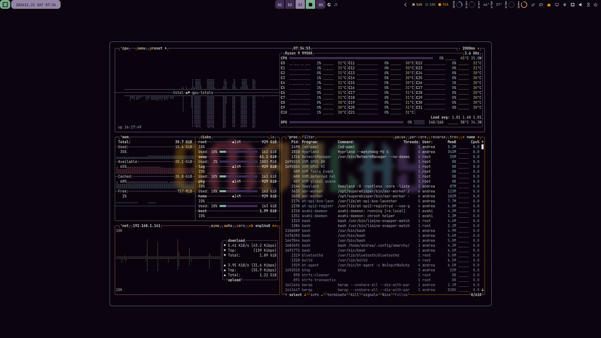
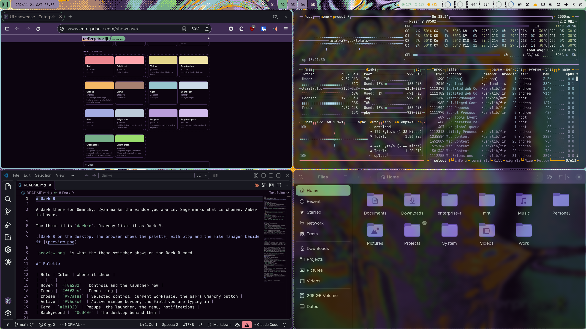
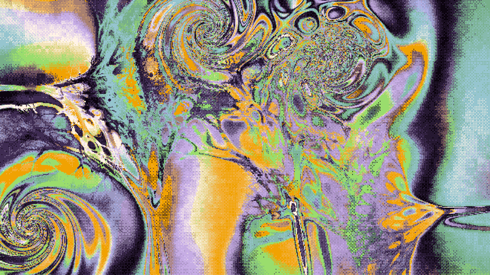
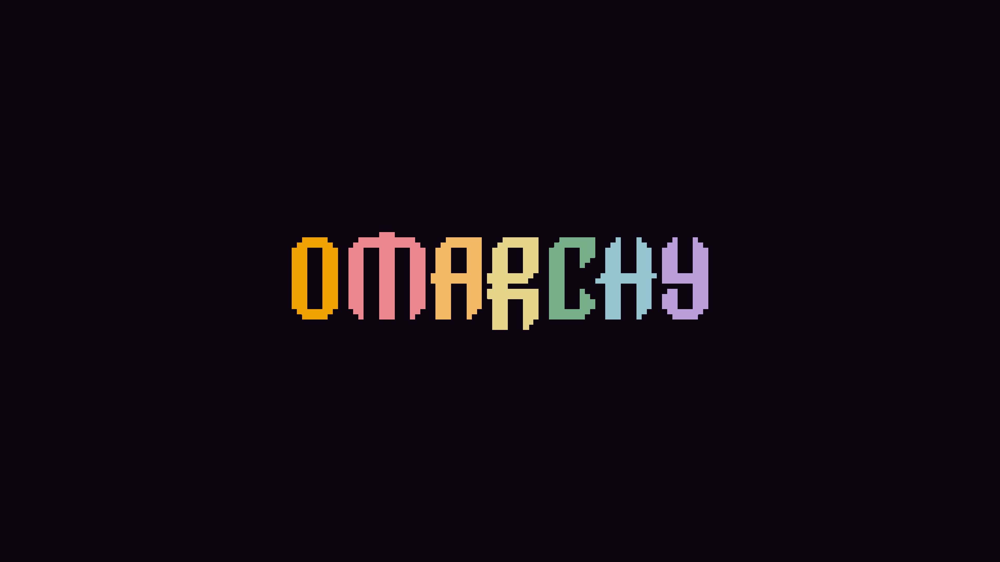
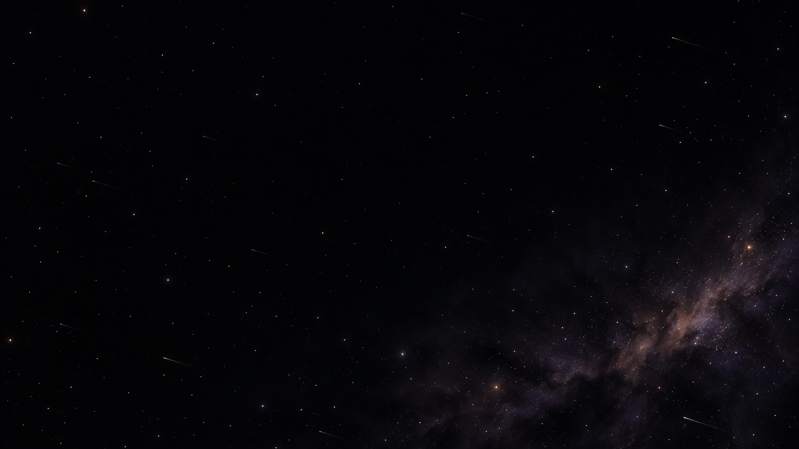
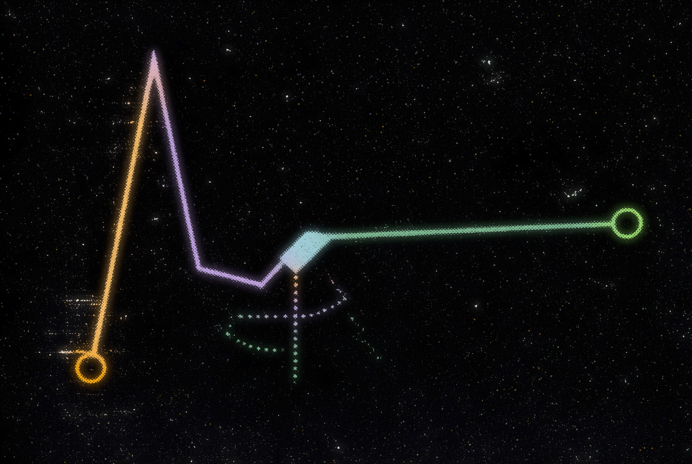

# Dark R

A dark theme for Omarchy. Cyan marks the window you are in. Sage marks what is
chosen. Amber is hover.





Tested with Omarchy 4.5.0.

## Install

```bash
omarchy theme install https://github.com/enterprise-r/omarchy-dark-r-theme
omarchy theme set "Dark R"
```

That is the whole theme. Omarchy names it from the repository, dropping
`omarchy-` and `-theme`, so it lands in `~/.config/omarchy/themes/dark-r` with
the id `dark-r`.

Update it with `omarchy theme update`, then `omarchy theme set "Dark R"`.
Running `omarchy theme install` again deletes the checkout and clones it fresh.

The [optional extras](#optional-extras) recolor GTK and Firefox and add the
Dark-R bar. The theme does not need them.

## What the theme sets

| File | What it sets |
|---|---|
| `colors.toml` | The palette. Omarchy builds the terminals, Neovim, btop, and the other app configs from it. |
| `shell.toml` | Bar, menu and launcher, lock screen, polkit dialog, and notifications. |
| `vscode-theme.json` | VS Code, Cursor, and Codium, with the editor on `background` and sidebars, panels, and fields lifted onto `lighter_background`. |
| `chromium.theme` | Chromium, Chrome, Edge, and Brave. A dark `#09070c` with the hue of `hyprland_inactive_border`, so the toolbar and new tab page come out near `#3f2c53` with a near-black tab strip, close to the Firefox extra. Chromium makes its own shades from this one color; a theme cannot set them exactly. |
| `unlock.png` | The boot and disk-unlock screen: the Omarchy wordmark, each letter a palette color. |
| `icons.theme` | `Yaru-purple`. |
| `backgrounds/` | Three wallpapers. |

Window borders come from `hyprland_active_border` and `hyprland_inactive_border`
in `colors.toml`. Window and terminal transparency stay with Omarchy's Glassy
setting.

## Palette

| Role | Color | Where it shows |
|---|---|---|
| Hover | `#f0a202` | Controls under the pointer |
| Focus | `#fff3e6` | Focus ring |
| Chosen | `#77af8a` | Selected control, menu and launcher row, current workspace, the bar's Omarchy button |
| Active | `#96c5cf` | Active window border, the field you are typing in |
| Card | `#181820` | Popups, the launcher, the menu, notifications |
| Background | `#0c040f` | The desktop behind them |

The full list is under [Where the colors go](#where-the-colors-go).

## Wallpapers

<table>
  <tr>
    <td></td> <td></td>
  </tr>
  <tr>
    <td></td> <td></td>
  </tr>
</table>

| File | What it is |
|---|---|
| `backgrounds/3sync-4k.png` | A fluid print in the palette. |
| `backgrounds/omarchy.webp` | The wordmark the stock themes ship, drawn on `#0c040f`. |
| `backgrounds/warp-cruise.png` | The wallpaper the theme returns to when the wallpapers extra finds no pictures. |
| `backgrounds/hyper-j-4k.jpg` | A glowing route in orange, lilac, and green across a starfield. |

The seven letters of the wordmark, here and in `unlock.png`, take seven colors
from the palette:

| O | M | A | R | C | H | Y |
|---|---|---|---|---|---|---|
| `#f0a202` | `#ec8790` | `#f4b965` | `#e4d58b` | `#77af8a` | `#96c5cf` | `#ba9eda` |
| amber | red | orange | yellow | sage | cyan | magenta |

`omarchy theme bg next` cycles the wallpapers. Pictures you add to
`~/.config/omarchy/backgrounds/dark-r/` join them.

## Optional extras

A theme cannot write outside its own directory, so these come from an installer
in the checkout. Run it as your desktop user:

```bash
cd ~/.config/omarchy/themes/dark-r
./install.sh --dry-run    # list every file it would change, and change nothing
./install.sh              # all four components
./install.sh gtk firefox  # only the ones you name
./install.sh --reinstall  # after omarchy theme update
./install.sh --uninstall
```

| Component | What it writes |
|---|---|
| `gtk` | A managed sheet in `~/.config/gtk-3.0/` and `~/.config/gtk-4.0/`, and a managed block in each GIMP 3 profile's `gimp.css`. GTK 3 themes compile their colors in, and GTK 4 and libadwaita ignore the theme name, so the user sheet is the only way in. |
| `firefox` | A managed `userChrome.css` in each Firefox profile. It turns on `toolkit.legacyUserProfileCustomizations.stylesheets` in that profile's `user.js`, which Firefox needs to read it. |
| `bar` | The Dark-R bar, in `~/.config/omarchy/plugins/` and `shell.json`. Needs a top or bottom bar. |
| `wallpapers` | Pictures placed directly in `~/Pictures/Wallpapers` become Dark-R wallpapers, linked into `~/.config/omarchy/backgrounds/dark-r/`. Subfolders are left out. While Dark-R is selected, the newest is shown when the current wallpaper is not one of them. |

Every install also keeps Dark-R's window geometry (4 px inner and 8 px outer
gaps, a 1 px border, 10 px rounding, no shadow) in a managed block in
`~/.config/hypr/looknfeel.lua`. The block is there only while Dark-R is the
active theme. Another theme gets Omarchy's own geometry back.

`--light` is short for `gtk firefox wallpapers`. `--reinstall` and `--uninstall`
keep the components of the first install. To change them, uninstall and install
again.

The GTK and Firefox colors, and the geometry block, are cleared when another
theme is applied and come back with Dark-R. The wallpaper links stay in Dark-R's
own backgrounds folder, and other themes keep their wallpaper. The hooks live in
`~/.config/omarchy/hooks/`. Reopen GTK 3, GIMP, GTK 4, and Firefox after a
switch if they keep the previous colors.

`omarchy theme update` updates the checkout, not the installed copies. When they
fall behind, the next theme switch says so once. Run `./install.sh --reinstall`
then.

The installer backs up what it replaces in
`~/.local/state/omarchy-dark-r/backups/`. A managed file you edited by hand
stops `--reinstall` and `--uninstall`, and they name the file. Uninstall leaves
Dark-R selected and the checkout in place. The installer never writes to
`/usr/share/omarchy`.

### The bar

The bar component swaps four Omarchy widgets for Dark-R copies:

- The Omarchy button is a sage pill at the screen edge.
- The workspaces are crumbs, moved to the center. The calendar and the workspace
  indicator trade places, unless you already replaced one of them.
- The clock is a chip that reads `yyyyMM.dd ddd HH:mm`. Its calendar is
  Omarchy's own.
- Active indicators are sage.

It adds a plate under the right side of the bar, and a starfield that starts
hidden. Right-click an empty part of the bar to show or hide the stars. They
stop while the bar is hidden and when `omarchy toggle animations` turns motion
off.

Each copy keeps Omarchy's behavior: every monitor's own block of workspaces,
scrolling, layout switching, translations, and IPC. Widgets you added yourself
stay where you put them. With any other theme the copies look like Omarchy's own
widgets. Their colors come from the `[dark-r]` section of `shell.toml`, and a
key in `~/.config/omarchy/shell.toml` overrides one.

## Where the colors go

The theme and the extras recolor. Control shapes stay with the application.

| Role | Color | Where it shows |
|---|---|---|
| Hover | `accent` `#f0a202` | Controls under the pointer |
| Keyboard focus | `bright_foreground` `#fff3e6` | Focus ring |
| Chosen | `green` `#77af8a` | Selected control, menu and launcher row, the bar's Omarchy button, selected tab, current workspace. That bar button hovers to `bright_green` `#9add6d` with no border |
| Active | `cyan` `#96c5cf` | Active window border, lock field while typing, focused field. The current workspace crumb uses it as a border |
| Occupied workspace | `dark_foreground` `#9385a5` | A crumb that has windows. Hover is `bright_green` `#9add6d`, with no border |
| Empty workspace | `hyprland_inactive_border` `#3f2c53` | A crumb with no windows. Hover is `bright_green` `#9add6d`, with dark text and no border |
| Card | `lighter_background` `#181820` | Popups, tooltip, launcher, menu, notifications, lock field. The border is `dark_foreground` |
| Dim | `dark_foreground` `#9385a5` | Placeholders, the clock chip. Resting control borders are `foreground` at 60%, which reads the same |
| Notices | `blue`, `green`, `accent`, `red` | Information, success, warning, error. A desktop notification uses the warning color |
| Header | `hyprland_inactive_border` `#3f2c53` | libadwaita header bars, the Firefox toolbar and tab strip, the Chromium toolbar, the VS Code title bar |
| Selection | `#3f2c53` under `bright_foreground` | Text selection. VS Code draws the same fill opaque |
| Links | `bright_magenta`, hover `bright_yellow`, visited `yellow` | GTK 4 and Firefox |
| Hover fill | solid `accent`, text `background` | GTK 4 and Firefox buttons, rows, tabs, and menus. VS Code tabs and the status bar. Lists and toolbars in VS Code hover with `#3f2c53`, so an amber match stays readable |
| Destructive | `red`, hover `bright_red` | GTK 3, GTK 4, and Firefox buttons |

## Development

`colors.toml` is the one source of the palette. After changing it, or
`templates/shell.toml.tpl`, rebuild the files that derive from it:

```bash
python3 scripts/build.py           # shell.toml, vscode-theme.json, and chromium.theme
python3 scripts/build.py --assets  # also unlock.png and preview-unlock.png
python3 scripts/build.py --check   # what CI runs
```

`vscode-theme.json` and the boot images use Omarchy's own template and assets,
so building them needs Omarchy installed. `intro.png` is the first image on this
page. `preview.png` is the second, and the theme preview Omarchy shows in the
switcher. After a new screenshot of that preview,
`python3 scripts/build.py --compress-preview` shrinks `preview.png`. It uses 256
colors, as the stock previews do, only when every theme color stays exact and no
pixel visibly changes. Otherwise it recompresses without loss.

The four bar widgets are copies of Omarchy's, each marked with the release it is
based on and with its own changes marked `Dark-R`. After an Omarchy update,
`scripts/fork-drift.sh` shows how far each has drifted. `--diff` prints the
diffs.

```bash
python3 -m unittest discover -s tests -v
```

The tests use temporary directories and leave the live desktop alone. With
Omarchy installed they also check `shell.toml` and the widgets against the
shell's own code.

## Credits

The wallpapers `3sync-4k.png`, `warp-cruise.png`, and `hyper-j-4k.jpg` are by
Andrea Ratto and covered by this repository's license. Originally based on
[LCARS for Omarchy](https://github.com/yzingher/omarchy-lcars-theme) by Yoav
Zingher (yzingher). The Omarchy wordmark in `unlock.png` and
`backgrounds/omarchy.webp`, and the bar widgets the Dark-R copies adapt, are
from [Omarchy](https://github.com/basecamp/omarchy) by David Heinemeier Hansson.

## License

MIT. See [LICENSE](LICENSE).
